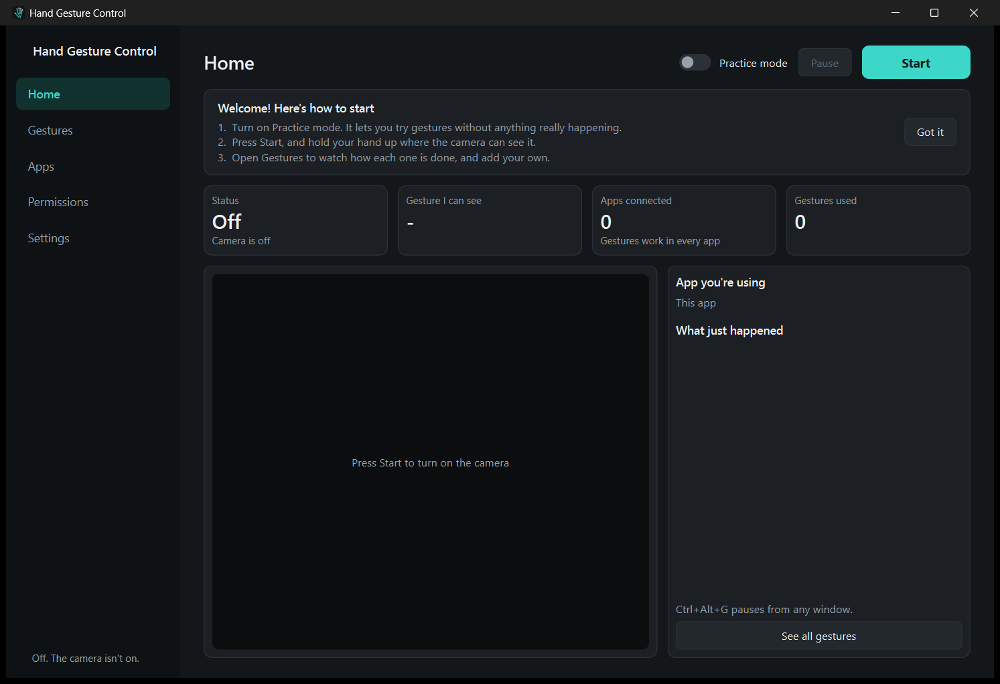

# Hand Gesture Control

[](LICENSE)


[](CONTRIBUTING.md)



Move the mouse, click, open apps and websites, and control media, volume and virtual desktops with
hand gestures, using an ordinary webcam. Everything runs locally: after a one-time model download, the
app makes no network connections of its own, and camera frames are never saved. The only exception is
a website gesture, which opens in your browser when you do it.

## Download

On Windows, download the zip from the [Releases page](../../releases), unzip it, and double-click
`HandGestureControl.exe`. You don't need to install Python. Keep everything in the unzipped folder together.

The builds aren't code-signed, so Windows may warn about them the first time. To run from source or on another
system instead, see [Setup](#setup).

## The desktop app

Open `HandGestureControl.exe`, or the **Hand Gesture Control** shortcut if you
[built it yourself](#building-the-exe-windows), then follow the welcome guide on the Home page. To add an icon to your
Desktop as well, use **Settings** in the app.

1. Turn on **Practice mode**. You can try gestures without anything really happening.
2. Press **Start**, and hold your hand up where the camera can see it.
3. Open **Gestures** to watch how each one is done, and to add your own.

| Page | What it's for |
| --- | --- |
| **Home** | Start, Stop and Pause, the camera picture, the gesture it can see, and what just happened |
| **Gestures** | The full list of gestures, each with a picture and an animated demo. Turn them on or off, change what they do, and add your own |
| **Apps** | Optional. Switch gestures off in an app, or make them do something different there |
| **Permissions** | What the app is allowed to do. It asks when a gesture needs something new, so you rarely need this page |
| **Settings** | Starting automatically, the swipe distance, fitting the pinch to your hand, the Desktop icon |

Closing the window keeps the app in the system tray, by the clock, and it keeps running if you had
started it. Right-click the tray icon to stop or quit. `Ctrl+Alt+G` pauses and resumes from any window.

### Using your laptop without a mouse

These gestures are ready to use, at the top of the Gestures page:

| To do this | Do this |
| --- | --- |
| **Move the cursor** | Point with your index finger, other fingers curled, and hold. Then move your hand |
| **Click** | While pointing, pinch thumb to index and let go |
| **Drag** | While pointing, pinch, and keep pinching as you move your hand |
| **Double click** | While pointing, raise your middle finger too, and hold briefly |
| **Stop pointing** | Open your palm, make a fist, or lower your hand |
| **Open an app** | Thumbs up. Opens File Explorer until you choose another app |
| **Open a website** | Thumbs down. Opens Google until you choose another website |

Press **Change** next to **Open an app** or **Open a website** to choose what opens. To have several, add
more gestures from the list further down the page. Thumbs up and thumbs down only work when you're not
pointing, so open your palm first. Allow about a second after stopping before the next gesture counts.

To avoid touching anything at startup, allow **Start with Windows** on the Permissions page, and turn on
**Start automatically when the app opens** in Settings. The camera then comes on when you sign in.

**You'll still need the keyboard or mouse for** typing, right-clicking and scrolling, as there are no
gestures for these yet. A gesture can type a fixed piece of text, or press a shortcut such as `ctrl+c`.

### Adding your own gesture

Press **+ Add a gesture** on the Gestures page, or **Add** next to a pose in the list. It takes three steps:

1. **Choose a hand pose.** Pick one from the list. These work straight away, with no recording.
2. **Choose what it does.** Play music, open a website, open an app, type some text, and more.
3. **Name it and try it.** Show the pose to your camera, and the app tells you if it recognises it.

| Pose from the list | How to do it |
| --- | --- |
| Rock sign | Raise your index and little fingers |
| Three fingers | Raise your index, middle and ring fingers |
| Call me | Stick out your thumb and little finger |
| Little finger | Raise only your little finger, thumb tucked |

Thumbs up and thumbs down are also on the list, but **Open an app** and **Open a website** use them. To use
one of these for something else, press **Change** next to that gesture.

Want a different hand shape? Choose **Record my own pose** and hold it in front of the camera for 3 seconds.
Keep your whole hand in view, use the hand you'll normally use, and pick a shape that looks clearly different
from your other gestures. The app tells you if a recording didn't work, or if the pose is already in use.

**If a gesture fires by accident,** make it hold longer under **More options**, or choose another pose.
**If it isn't recognised,** try better light, and show your whole hand.

### Doing several things in a row

When choosing what a gesture does, press **Do several things in a row** to build a list of steps. For example:
open your browser, wait 2 seconds, then press `ctrl+t`.

| Step | Example | Needs permission |
| --- | --- | --- |
| Built-in action | Play / pause, next desktop, screenshot | Keyboard shortcuts |
| Press shortcut | `ctrl+shift+s` | Keyboard shortcuts |
| Open app | Any installed app | Open apps |
| Open website | `https://calendar.google.com` | Open websites |
| Type text | `On my way!` | Type text |
| Wait | `500 ms` | None |

If a permission is missing, the app asks when you save. A gesture that's still missing one shows a note in
amber, and doesn't run at all rather than running only half of its steps.

### Apps

You don't need this page for gestures to work. Add an app here to:

- **Switch gestures off in it,** for example while playing a game, or make gestures work only in the apps you list.
- **Make gestures do something different in it** with **Change gestures here**. For example, swipe right can press
  the right arrow in PowerPoint and still skip tracks everywhere else. This follows whichever app you're using.

This app's own window always responds, so you can test gestures from it. Detecting the front app works on
Windows only.

### Permissions

Six are on by default, because the ready-to-use gestures need them: Camera, Keyboard shortcuts, Mouse control,
System volume, Open apps and Open websites. **Type text** and **Start with Windows** start off, and the app asks
when a gesture you're saving needs one. Updating the app doesn't change permissions you've already set, so if you
turned one off, the gesture that needs it shows a note in amber. A separate Windows setting can also block the
camera, so the page shows its status and links to it.

## Gestures

| Gesture | How to do it | What it does |
| --- | --- | --- |
| **Pointer (air mouse)** | Point with the index finger, other fingers curled, and hold | Enters air mouse mode |
| **Click** | In air mouse mode, pinch thumb to index | Left click, or drag if you keep pinching and move |
| **Double click** | In air mouse mode, raise your middle finger too | Double click |
| **Open an app** | Fist with the thumb pointing up | Opens File Explorer |
| **Open a website** | Fist with the thumb pointing down | Opens `https://www.google.com` |
| **Fist** | Close all fingers with the thumb tucked | Play/pause |
| **Open palm swipe** | Move an open hand quickly sideways | Next/previous track |
| **Peace sign** | Raise index and middle fingers | Next virtual desktop; lean your hand left for the previous one |
| **Volume pinch** | Touch thumb to index with the other three fingers **up** (an "OK" sign) and hold | Enters volume mode |

These are the defaults. Change what they do on the **Gestures** page. Click and double click have a fixed job,
so they can only be turned on or off.

**In volume mode**, spreading or closing your thumb and index finger sets the volume. The level
does not change until your fingers reach the current level: an amber marker on the bar shows
where they are, and the bar turns teal once it has caught on. Then it follows you. To finish,
make a fist or take your hand out of view; the last moment of movement is undone, so the volume
stays where you set it.

**In air mouse mode**, your index fingertip moves the cursor. Pinching thumb to index presses the
left button and releasing lets go, so a quick pinch clicks and a pinch-and-move drags. Raising your
middle finger next to your index finger double clicks once; lower it before doing it again. To finish,
show an open palm or a fist, or take your hand out of view. The button is always released when
you leave the mode, when tracking is lost, when you pause and when you quit.

Modes are how one pose can mean two things. A pinch only clicks once you are in air mouse mode, and
changes the volume otherwise. A peace sign double clicks in air mouse mode, and switches desktop
otherwise. After leaving a mode, gestures are ignored for 0.8 s so that the pose you used to leave
doesn't fire its own action.

## Setup

Requires Python 3.10 to 3.14, on Windows, Apple Silicon macOS 14 or later, or Linux (X11). MediaPipe
1.2.0 has no build for Intel Macs. Developed and tested on Windows 11 with Python 3.14 only.

```powershell
# Windows
python -m venv .venv
.venv\Scripts\python -m pip install -r requirements.txt
.venv\Scripts\python scripts\download_model.py
.venv\Scripts\python scripts\create_shortcut.py
```

`create_shortcut.py` makes a Desktop icon that runs the source code with `.venv`, so re-run it if you move
them. To use the .exe instead, build it as described below, and add the icon from **Settings** in the app.
PySide6 installs very deep paths: if pip reports a path that is too long, use a shorter project folder.

```bash
# macOS / Linux
python3 -m venv .venv
.venv/bin/python -m pip install -r requirements.txt
.venv/bin/python scripts/download_model.py
```

`download_model.py` needs internet access once. It verifies the model against a pinned SHA-256
hash. The commands below use the Windows form; on macOS or Linux, use `.venv/bin/python`.

### Building the .exe (Windows)

```powershell
.venv\Scripts\python -m pip install -r requirements-dev.txt
.venv\Scripts\python scripts\build_exe.py
```

The model has to be downloaded first, as above. The build took about 90 seconds on the development machine, and
puts these in the project folder:

| Item | What it is |
| --- | --- |
| `HandGestureControl.exe` | The app. It has no console window |
| `_internal` | Its own copy of Python and the libraries, about 350 MB. It doesn't use `.venv` |
| **Hand Gesture Control** shortcut | Opens the .exe |

The build then runs `HandGestureControl.exe --self-test`, and stops with the details if that fails. This loads
the libraries and the hand model and runs the detector once on a blank image, without using the camera or
pressing anything.

- **After changing the code,** rebuild: the .exe doesn't pick up changes by itself. Quit the app from the tray first.
- **Keep the .exe with its folders.** It needs `_internal`, and uses the `models`, `assets` and `user_data` folders
  beside it. Your settings are shared with `app.pyw`.
- **If you move the project folder,** the .exe still works, but the shortcut won't, as it stores the full path.
  Rebuild to recreate it. Any Desktop icon needs adding again in Settings, and **Start with Windows** turning off and on.
- **Icons made from `app.pyw` keep running `app.pyw`.** To switch a Desktop icon or **Start with Windows** to the
  .exe, set it again while running the .exe.

`build\` only holds temporary build files, and is safe to delete. Add `--package` to also make the zip that goes on
the Releases page, in `build\`. It leaves out your settings. Pushing a version tag makes one automatically: see
[CONTRIBUTING.md](CONTRIBUTING.md#making-a-release).

If you see two copies of OpenCV in an existing environment, run
`pip uninstall opencv-python opencv-contrib-python` and then reinstall the requirements. MediaPipe
needs `opencv-contrib-python`, and the two packages overwrite each other's files.

### Permissions

- **Windows:** Settings > Privacy & security > Camera. Turn on **Camera access** and **Let desktop
  apps access your camera**.
- **macOS:** System Settings > Privacy & Security. Allow your terminal app under both **Camera**
  and **Accessibility**. Accessibility is what lets it press keys and move the cursor. Restart
  the terminal afterwards.
- **Linux:** your user must be able to read `/dev/video0` (usually via the `video` group). Volume
  uses `pactl`. Key and mouse control needs an X11 session, as pynput cannot do this on Wayland.

## Running from the command line

The desktop app is the normal way to run this. There's also a command line version, which uses the
default gestures and ignores the app's saved settings. It runs from source, not from the .exe, so it needs
the `.venv` from Setup. `--dry-run` is its equivalent of Practice mode:

```powershell
.venv\Scripts\python main.py --dry-run --debug
.venv\Scripts\python main.py
```

| Control | Effect |
| --- | --- |
| `Q` or `Esc` (window focused) | Quit |
| `P` (window focused) | Pause or resume |
| `Ctrl+Alt+G` (from anywhere) | Pause or resume. Use this when another window has focus |

Options: `--camera N`, `--scale 0.5`, `--every-n 2`, `--max-fps N`, `--no-preview`, `--seconds N`,
`--fist-action`, `--swipe-action`, `--dry-run`, `--debug`, `--calibrate`.

## Calibration

Press **Fit to my hand** under **Settings** (or run `main.py --calibrate`). This asks you to touch your thumb
and index finger for a few seconds, then spread them wide. It saves your range to `calibration.json`,
which sets when a pinch registers and what counts as 0% and 100% volume. It applies the next time you
press Start. Delete the file to return to the defaults.

Hold times, cooldowns and swipe distance are set in the app. Everything else is in [config.py](config.py).
Run `main.py --dry-run --debug` to see the values the recognizer is working with: joint angles, and the
state of each finger (`ext`, `cur` or `unc`).

| Problem | Setting in `config.py` |
| --- | --- |
| Cursor is jittery | Lower `FilterConfig.cursor_min_cutoff` |
| Cursor lags behind | Raise `FilterConfig.cursor_beta` |
| Screen edges are hard to reach | Shrink `PointerConfig.active_region` |
| A finger is stuck on `unc` or misread | `RecognizerConfig` angle thresholds |
| A fist isn't recognised | Raise `RecognizerConfig.fist_thumb_max_ratio` |

## Performance

Measured on the development machine, a 4-core Windows 11 laptop with no dedicated GPU:

| Measurement | Result |
| --- | --- |
| Detector time per frame, typical | 11 to 20 ms, enough for 50 to 90 FPS |
| Detector time per frame, 95th percentile | About 30 ms |
| Raw webcam rate, with no app code running | 25 to 30 FPS, varying between runs |
| App rate | Keeps up with the camera; 30 FPS at best |

In practice **the webcam sets the frame rate, not the software**. Most laptop webcams are capped at
30 FPS and slow down in dim light as exposure gets longer, so good lighting is the easiest way to
gain speed. Raising the resolution can hurt badly: on this camera, 1280x720 gives only 10 FPS. The
default of 640x480 is deliberate, as the model rescales its input anyway.

On slower hardware, `--every-n 2` halves the detector's workload. `--scale 0.5` saves little, since
it only shortens frame preparation.

## Troubleshooting

- **Black window or "Could not open camera":** check the permissions above and close other apps that
  use the camera. Try another camera number in Settings if you have more than one.
- **Nothing happens when you open the app:** it may already be running in the tray. Opening it again should
  bring the window back. If something goes wrong, details are in `user_data\app.log`.
- **The .exe says "Failed to load Python DLL":** the `_internal` folder is missing or isn't beside the .exe. Run
  `scripts\build_exe.py` again.
- **"Hand model not found":** the `models` folder has to be beside the .exe. Run `scripts\download_model.py` once while online.
- **The build stops with `PermissionError`:** the app is probably still running, so the old .exe can't be replaced.
  Quit it from the tray and build again.
- **Your custom gesture doesn't fire:** check that its row on the Gestures page doesn't show a missing permission,
  and use the hand you recorded with. Re-record it in the lighting and position you normally use.
- **"Blocked: ... is not connected" under What just happened:** you've chosen to make gestures work only in the
  apps you list. Add that app, or change the choice on the Apps page.
- **Double click happens by accident, or not at all:** keep your middle finger clearly curled while pointing, and
  straight when you raise it. Hold it up for a moment, as a quick flick is ignored on purpose.
- **Clicks miss or don't register:** try **Fit to my hand** under Settings.
- **Thumbs up or down does nothing:** open your palm first if you're pointing, and hold your thumb straight up or
  down. Sideways doesn't count.
- **Low FPS:** add light. The FPS display reports what the camera actually delivers.
- **Gestures do nothing inside one particular app:** Windows blocks simulated input to apps running as
  administrator, unless this app is also run as administrator. Task Manager is a common example.
- **Desktop switching does nothing:** create a second virtual desktop first. On Windows, you can't go
  past the first or last desktop. On macOS, enable the Mission Control shortcuts under Keyboard settings.
- **Media keys do nothing:** a media app has to be open. Browsers usually respond to these keys too.
- **Volume won't go any lower or higher while pinching:** run `--calibrate`. If your spread falls short
  of the configured maximum, high levels can't be reached.
- **Hand not detected:** keep your whole hand in view, about 30 to 80 cm from the camera. Strong
  backlight, such as a window behind you, makes tracking worse.

## Architecture

```text
HandGestureSoftware/
├── HandGestureControl.exe   The built app (made by build_exe.py)
├── Hand Gesture Control.lnk Shortcut to the .exe (made by build_exe.py)
├── _internal/               The .exe's Python and libraries (made by build_exe.py)
├── build/                   Temporary build files (made by build_exe.py)
├── app.pyw                  Desktop app entry point
├── main.py                  Command line entry point
├── config.py                Low-level tuning values
├── requirements.txt         Pinned runtime dependencies
├── requirements-dev.txt     Adds pytest, Ruff, Pillow and PyInstaller
├── ruff.toml                Code style checks
├── CHANGELOG.md             What changed in each version
├── CONTRIBUTING.md          How to help, and the project's rules
├── THIRD_PARTY_NOTICES.md   The licenses of what this app uses
├── .github/                 Automated tests and releases, issue and pull request forms
├── docs/images/             Pictures for this README
├── assets/                  App icon
├── models/
│   └── hand_landmarker.task MediaPipe model (downloaded)
├── user_data/               Your settings, custom gestures and log (created by the app)
├── scripts/
│   ├── download_model.py    One-time model download, with hash check
│   ├── create_shortcut.py   Creates the Desktop icon
│   ├── build_exe.py         Builds the .exe and its shortcut, using HandGestureControl.spec
│   └── make_icon.py         Regenerates the icon
├── gesture_control/
│   ├── engine.py            The processing loop, shared by the app and the command line
│   ├── capture.py           Capture: camera thread, FPS limit, preprocessing
│   ├── detection.py         Detection: MediaPipe wrapper, landmark smoothing
│   ├── filters.py           One-Euro filter
│   ├── recognizer.py        Recognizer: one frame of landmarks to one gesture label
│   ├── custom_gestures.py   Records and matches your own poses
│   ├── stability.py         Hold-to-confirm state machine, swipe detector
│   ├── actions.py           Action mapper: modes, cooldowns, volume and cursor logic
│   ├── router.py            What a gesture does now, given the front app and permissions
│   ├── steps.py             Step types, validation and running, with permission checks
│   ├── profile.py           Saved settings
│   ├── app_watch.py         Running apps and the front app
│   ├── os_control.py        Keys, mouse and volume per OS, plus the practice-mode stand-in
│   ├── shell_integration.py Desktop and startup shortcuts, Windows camera setting
│   ├── self_test.py         Checks that a built .exe can load everything it needs
│   ├── overlay.py           HUD drawn on the camera view
│   ├── calibrate.py         Pinch calibration
│   └── gui/                 The desktop app: window, pages, add-a-gesture wizard, demos
└── tests/                   Test suite, with landmark data from real hand photos
```

```text
Camera -> capture -> detection -> recognizer -> stability -> action mapper -> router -> steps -> OS
                                                                 |              |
                                                              overlay    profile, front app
```

The app's window runs on the main thread and the engine on its own. Settings reach a running engine as a
private copy, swapped in between frames, so changes apply immediately and can't be seen half-finished.

Some design choices that are not obvious from the brief:

- **Finger states combine two sources.** MediaPipe's 3D landmarks handle camera distance and hand rotation
  well, but on some views they report a straight finger as sharply bent. The 2D image can overrule them when
  it is decisive, since a camera can hide a bend but can't fake a long straight finger.
- **Swipes bypass hold-to-confirm.** A fast hand blurs and misses frames, so requiring consecutive open-palm
  frames would reject the very motion being detected. Swipes require a share of frames in a time window
  instead, and ignore the return stroke.
- **The cursor freezes during a click.** Pinching moves the fingertip, which would otherwise pull the cursor
  off its target. It stays frozen until it has moved far enough to count as a drag.
- **Double click is a raised finger, not two quick pinches.** Two pinches inside Windows' double click time are
  hard to do reliably on a 30 FPS camera. Raising the middle finger leaves the index fingertip in place, and the
  cursor is frozen from the first frame of it.
- **Your own gestures beat the built-in poses.** A thumbs-up gesture saved before thumbs up had a default use keeps
  working as before, and the default is switched off for it.
- **pynput rather than pyautogui.** pyautogui adds a default delay after each call, which a 30 Hz cursor
  can't afford.
- **The .exe is a folder build, not a single file.** A single-file .exe would unpack hundreds of megabytes every
  time it opens, which is slow for an app that also starts with Windows.
- **The built app has a self-test.** The slow libraries only load when you press Start, so a bundle missing one
  would still open normally and only fail later, with no console to show why.

## Tests

```powershell
.venv\Scripts\python -m pip install -r requirements-dev.txt
.venv\Scripts\python -m pytest
```

The recognizer tests use landmarks the real model produced from photos of each pose, both raw and mirrored.
Only the numbers are stored. The mapper tests run scripted sessions against a fake OS, and the GUI tests drive the
real windows without showing them, with a temporary profile, so nothing on your machine is touched.

These run from source, so they don't check the .exe. `scripts\build_exe.py` does that with its self-test.

## Contributing

Contributions are welcome, including testing on macOS and Linux, and reports of how gestures work with your camera.
See [CONTRIBUTING.md](CONTRIBUTING.md) to get started, and please follow the [Code of Conduct](CODE_OF_CONDUCT.md).
To report a security problem, see [SECURITY.md](SECURITY.md).

## License

Released under the [MIT License](LICENSE). The libraries and the model this app uses have their own licenses, listed
in [THIRD_PARTY_NOTICES.md](THIRD_PARTY_NOTICES.md).
